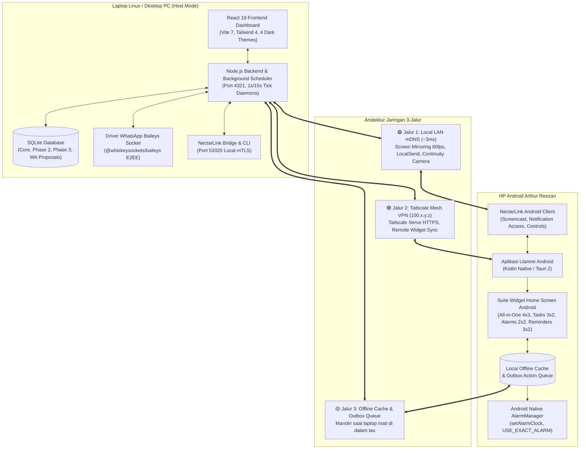
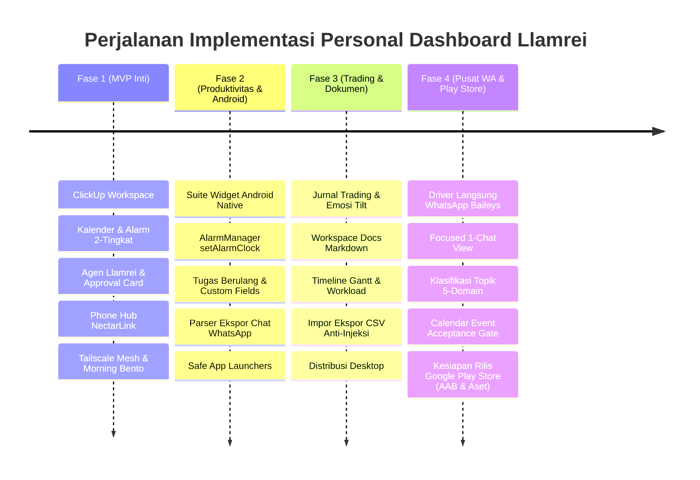

# PRD & Implementation Plan — Personal Dashboard Llamrei (v3.0 — Comprehensive & Production-Ready)

**Tanggal Pembaruan:** 19 November 2026 · **Owner & Co-Commander:** @Arthur Reezan · **Status:** Production-Ready (Fase 1, 2, 3 Selesai & Suite Build Android Siap Rilis)

---

## 1. Ringkasan & Visi Produk

**Personal Dashboard Llamrei** adalah sistem komando personal satu pintu (*Personal Command, Phone Hub & Life OS*) yang dibangun khusus untuk alur kerja Arthur Reezan sebagai trader aktif, mahasiswa tingkat akhir FEB UKRIDA, dan pemimpin organisasi mahasiswa. 

Llamrei menyatukan:
1. **Manajemen Kerja Mendalam ala ClickUp** yang terhubung langsung ke kalender dan sistem alarm 2-tingkat (di Web, Desktop, dan HP Android).
2. **Asisten AI Co-Commander (Llamrei)** yang responsif dengan eksekusi alat (*tool calling*), kartu persetujuan (*Approval Card*), dan riwayat pembatalan (*1-Click Undo*).
3. **Pusat Komunikasi WhatsApp Terpadu:** integrasi langsung *web socket* via **Baileys (`@whiskeysockets/baileys`)** dengan pemasangan kode QR, obrolan fokus per-chat (*Focused Chat Modal*), parser ekspor chat (.txt/.zip), klasifikasi topik 5-domain (*Tugas Kuliah, Skripsi, Rapat Organisasi, Ajakan Pergi, Umum*), dan gerbang persetujuan proposal acara kalender (*Strict Calendar Acceptance Gate*).
4. **Pusat Kontrol & Cermin Smartphone (Phone Hub via NectarLink):** kontrol HP penuh tanpa perlu *USB Debugging / Developer Mode*, *Screencast Mirror 60fps*, balas notifikasi langsung dari PC, pemicu kamera dokumen (*Continuity Camera*), dan sinkronisasi berkas/clipboard secepat Wi-Fi lokal.
5. **Suite Widget Home Screen Android Native (Kotlin Jetpack Glance / AppWidgetProvider):** 4 widget layar depan (1 *All-in-One* + 3 *Modular*) yang terikat ke sistem alarm tepat waktu Android (`AlarmManager.setAlarmClock()`) dengan cache luring (*Offline Cache*) dan rekonsiliasi otomatis saat laptop mati.
6. **Life OS & Analisis Performa Trader:** *10-Second Morning Check-In*, pencegah burnout & trading tilt (*Trader Tilt Guard*), penjadwal cerdas (*Energy & Market-Aware Auto-Scheduler*), metrik KPI nyata, dan **Jurnal Trading Digital** yang secara langsung mengorelasikan emosi trading dengan skor kesiapan pagi.
7. **Arsitektur Konektivitas 3-Jalur:** *Local LAN mDNS/QUIC* (latensi ~3 ms) + *Tailscale Mesh VPN (`100.x.y.z` & HTTPS privat `tailscale serve`)* + *Offline Delta Reconcile*.
8. **Kesiapan Distribusi Desktop & Google Play Store:** mode desktop mandiri (*Linux `--app` window* & *Windows batch*), serta skrip pembangun paket Android (`.apk` & `.aab`), aset grafis (ikon 512x512, banner 1024x500), kebijakan privasi, dan formulir keamanan data Google Play.

---

## 2. Masalah yang Diselesaikan & Batasan Sistem

### 2.1 Masalah Utama
- **Fragmentasi Alat:** Perpindahan konstan antara WhatsApp, kalender, aplikasi todo, chart TradingView, portal berita, dan kamera dokumen memicu *context-switching fatigue*.
- **Alarm & Tenggat yang Terlewat:** Tugas bertanggal di todo list konvensional sering terlewat karena tidak membunyikan alarm keras di HP dan website secara simultan.
- **Keterputusan Lintas Jaringan:** Sinkronisasi laptop ↔ HP kerap terputus saat berpindah dari Wi-Fi rumah ke jaringan kampus/seluler atau saat laptop tidur di dalam tas.
- **Risiko Emosional Trading:** Trader sering mengalami *tilt* (FOMO/Revenge trading) ketika berdagang dalam kondisi lelah fisik atau saat berita berdampak tinggi (*High-Impact News*) dirilis tanpa persiapan.
- **Inundasi Pesan WhatsApp:** Permintaan rapat, revisi skripsi, atau tugas kuliah di grup WA mudah tenggelam tanpa tindak lanjut terstruktur.

### 2.2 Batasan Sistem (Non-Goals & Safety Boundaries)
- **Bukan Robot Eksekusi Trading:** Sistem tidak mengeksekusi order finansial otomatis atau memberikan nasihat investasi. Seluruh keputusan trading berada di tangan pemilik.
- **Tanpa Port Publik Terbuka:** Tidak membuka port HTTP/TCP publik secara sembarangan ke internet; akses jarak jauh hanya diizinkan melalui jaringan privat terenkripsi **Tailscale WireGuard**.
- **Persetujuan Mutlak Pesan Keluar (*Approve-Then-Send*):** Agen Llamrei dan penjadwal otomatis dilarang keras mengirim pesan keluar tanpa persetujuan eksplisit pengguna (**Approval Card**).
- **Keamanan Token & Sandbox Launchers:** Peluncur aplikasi hanya mengeksekusi perintah biner yang masuk dalam daftar putih (*whitelist*) aman; sistem tidak pernah membungkus atau menyadap token aplikasi pihak ketiga.

---

## 3. Matriks Modul & Status Implementasi

| Modul | Deskripsi Kapabilitas Utama | Relevansi | Status Implementasi |
| :--- | :--- | :--- | :--- |
| **Morning Bento & Life OS** | Check-in 10 detik, *Trader Tilt Guard*, hitung mundur alarm, status baterai HP, sesi pasar WIB, chart TradingView, berita Finnhub/RSS, dan kalender ekonomi. | Sangat Tinggi | **Selesai (Fase 1)** |
| **ClickUp Workspace Engine** | Hierarki Space → Folder → List → Task → Subtask, List/Board/Calendar View, *Time Tracker* presisi, Tugas Berulang, Custom Fields, dan Task Templates. | Sangat Tinggi | **Selesai (Fase 1 & 2)** |
| **Sistem Alarm 2-Tingkat & Kalender** | Sinkronisasi dua arah Task ↔ Kalender, Soft Reminder otomatis, dan Hard Alarm bersirine Web Audio yang menderingkan HP via NectarLink dan Android native. | Sangat Tinggi | **Selesai (Fase 1)** |
| **Agen Co-Commander Llamrei** | Streaming LLM via Gemini API, *tool-calling*, Approval Card, audit logs, 1-Click Undo, dan prompt sistem anti-generik. | Sangat Tinggi | **Selesai (Fase 1)** |
| **Jadwal Pesan Berpersetujuan** | Perancangan draf pesan, optimasi waktu kirim kalender, antrean Background Scheduler, dan multi-channel dispatch dengan fallback 1-klik `wa.me`. | Tinggi | **Selesai (Fase 1)** |
| **Pusat Komunikasi WhatsApp** | Koneksi langsung socket Baileys dengan QR code pairing, obrolan fokus per-chat (*Focused Chat Modal*), parser ekspor (.txt/.zip), deteksi topik detail, dan *Event Proposal Acceptance Gate*. | Sangat Tinggi | **Selesai (Fase 1, 2, 4)** |
| **Phone Hub (NectarLink)** | Telemetri baterai/koneksi, Screencast 60fps mirror/kontrol tanpa developer mode, Auto-DND saat deep work, Continuity Camera ke tugas ClickUp, dan transfer berkas LocalSend. | Sangat Tinggi | **Selesai (Fase 1 & 2)** |
| **Android Native Widgets Suite** | 4 Widget layar depan Android (Kotlin Jetpack Glance / AppWidgetProvider), integrasi native `AlarmManager.setAlarmClock()`, offline snapshot cache, dan outbox reconcile. | Sangat Tinggi | **Selesai (Fase 2)** |
| **Jurnal Trading Analitis** | Jurnal trading lengkap dengan R-multiple, PnL, emosi trading, dan kalkulasi korelasi otomatis terhadap skor *Morning Check-In / Tilt Guard*. | Tinggi | **Selesai (Fase 3)** |
| **Dokumen & Alat Kolaborasi** | Dokumen Markdown terhubung (*Workspace Docs*), analisis beban kerja & Gantt timeline, serta impor/ekspor CSV & Markdown dengan proteksi injeksi formula. | Tinggi | **Selesai (Fase 3)** |
| **Konektivitas 3-Jalur & Keamanan** | Local LAN mDNS QUIC + Tailscale Mesh VPN (`100.x.y.z`) + Offline Cache di HP, ditambah proteksi CSRF, header guards, dan vault penyimpanan kunci aman. | Sangat Tinggi | **Selesai (Fase 1 & 2)** |
| **Paket Distribusi & Kesiapan Rilis** | Peluncur desktop standalone (`start-llamrei.sh` & `.bat`), skrip build AAB/APK Android, formulir Data Safety Google Play, dan aset grafis listing toko lengkap. | Tinggi | **Selesai (Fase 3 & Play Store)** |

---

## 4. Persyaratan Fungsional Lengkap (FR-01 s/d FR-81)

Terdapat **81 kebutuhan fungsional** yang telah didefinisikan, diimplementasikan, dan diuji (16/16 *automated tests* lolos secara *end-to-end*).

### 4.1 Chatbot, Agen Llamrei & Interaksi Suara (FR-01 s/d FR-09, FR-78)
- **FR-01 [Selesai]:** Percakapan teks interaktif dengan respons mengalir (*streaming response*); seluruh riwayat percakapan tersimpan secara lokal di SQLite.
- **FR-02 [Selesai]:** Tombol kontekstual *"Tanya / Suruh Llamrei"* pada jadwal, kartu tugas, alarm aktif, notifikasi HP, atau berita pasar agar konteks dikirimkan otomatis.
- **FR-03 [Selesai]:** Konfigurasi model AI fleksibel via `AiProvider` dengan penyimpanan kunci API di brankas terenkripsi (`libsecret` di Linux / local encrypted vault) disertai *circuit breaker* kuota bulanan.
- **FR-04 [Selesai]:** Fitur ringkas dan terjemahkan berita pasar atau pembaruan AI dengan penandaan resmi *"Dibuat AI"*.
- **FR-05 [Selesai]:** Eksekusi perintah bahasa natural menggunakan pemanggilan alat (*tool calling*) untuk manipulasi tugas ClickUp, alarm/kalender, penjadwal pesan, kontrol HP NectarLink, dan analisis Life OS.
- **FR-06 [Selesai]:** Mekanisme *Approval Card* wajib untuk setiap aksi agen yang mengubah data atau menyusun jadwal pesan keluar sebelum aksi benar-benar dieksekusi.
- **FR-07 [Selesai]:** Pencatatan riwayat audit lengkap (*audit logs*) untuk setiap tindakan otomatis dengan tombol **1-Klik Undo** yang membatalkan perubahan secara atomik.
- **FR-08 [Selesai]:** Briefing pagi terpadu (*Morning Command Briefing*) yang menyajikan skor energi/tilt, agenda kalender hari ini, hitung mundur alarm terdekat, tugas prioritas, dan berita pasar utama.
- **FR-09 [Selesai]:** Mode percakapan suara (*Voice Mode*) opsional untuk transkripsi perintah dan sintesis audio balasan agen.
- **FR-78 [Selesai]:** Integrasi Web Speech API dan Audio Synthesizer lokal pada modul `src/lib/voice.ts` untuk pengenalan suara bebas latensi.

### 4.2 Manajemen Kerja Mendalam ala ClickUp (FR-10 s/d FR-21, FR-75 s/d FR-77)
- **FR-10 [Selesai]:** Struktur hierarki lengkap: `Space → Folder → List → Task → Subtask` disertai daftar periksa tindakan (*Action Checklists*).
- **FR-11 [Selesai]:** Entitas tugas dengan status kustom per List, prioritas 4 tingkat berbendera (`Urgent`, `High`, `Normal`, `Low`), estimasi menit, Soft Reminder, sakelar **`⏰ Hard Alarm`**, tag berwarna, deskripsi Markdown, dan lampiran berkas.
- **FR-12 [Selesai]:** Multi-tampilan antarmuka dari sumber data yang sama: **List View** (tabel terkelompok), **Board View (Kanban drag-and-drop)**, **Calendar View**, dan **Slide-over Task Detail Drawer**.
- **FR-13 [Selesai]:** Filter pencarian multi-kriteria, pengelompokan (*group by status / priority / deadline*), dan pencarian instan global.
- **FR-14 [Selesai]:** Relasi ketergantungan antar tugas (*Waiting on* / *Blocking*).
- **FR-15 [Selesai]:** Mesin tugas berulang (*Recurring Tasks Engine*) yang mendukung aturan `daily`, `weekdays`, `weekly`, dan `monthly` dengan logika klem akhir bulan otomatis (mis. 28/29 Feb atau 31 Jan).
- **FR-16 [Selesai]:** Kolom kustom fleksibel (*Custom Fields*: teks, angka, tanggal, opsi pilihan, link) yang disimpan dalam struktur JSON terisolasi.
- **FR-17 [Selesai]:** Stopwatch pelacak waktu (*Time Tracker*) aktif di sidebar per tugas dengan agregasi harian/mingguan dan otomatis memicu mode DND ke HP Android.
- **FR-18 [Selesai]:** Kemampuan agen Llamrei memanipulasi ruang kerja (membuat tugas, mengubah status, memecah subtugas, mengatur alarm) secara programatik melalui perintah pengguna.
- **FR-19 [Selesai]:** Dokumen terhubung (*Workspace Docs*): pembuatan dokumen Markdown terstruktur yang terikat langsung ke Space atau Task tertentu (`workspace_docs`).
- **FR-20 [Selesai]:** Tampilan Timeline (Gantt) dan rekapitulasi beban kerja mingguan (*Workload Summary*).
- **FR-21 [Selesai]:** Mesin impor dan ekspor data CSV & Markdown dengan sanitasi keamanan ketat terhadap serangan *CSV formula injection* (`=`, `+`, `-`, `@`).
- **FR-75 [Selesai]:** Penyunting dokumen Markdown bawaan di antarmuka dengan fitur auto-save dan penautan kontekstual ke tugas aktif.
- **FR-76 [Selesai]:** Validasi kuotasi dan sanitasi karakter formula saat membaca maupun menghasilkan berkas CSV ekspor/impor.
- **FR-77 [Selesai]:** Pustaka templat tugas siap pakai (*Task Templates*: Rutinitas Pre-Market Trading, Checklist Skripsi FEB UKRIDA, dll.) dengan seeding database awal.

### 4.3 Pesan Terjadwal Berpersetujuan (FR-22 s/d FR-26)
- **FR-22 [Selesai]:** Penyusunan draf pesan terjadwal oleh Llamrei (nama kontak, tujuan, draf teks, jam pengiriman) yang disajikan dalam *Approval Card*.
- **FR-23 [Selesai]:** Saran jam pengiriman cerdas oleh Llamrei berdasarkan kalender pengguna, riwayat jam aktif kontak, dan zona waktu.
- **FR-24 [Selesai]:** Eksekusi pengiriman otomatis oleh *Background Scheduler* saat jam tiba hanya untuk pesan berstatus **`APPROVED`** melalui Baileys WA, Gateway Webhook, NectarLink Handoff, Telegram Bot, atau SMTP, disertai tombol **Fallback 1-Klik `wa.me`**.
- **FR-25 [Selesai]:** Pelacakan status pesan menyeluruh (`Pending Approval`, `Approved / Queued`, `Sent Auto`, `Fallback Ready`, `Sent Manual`, `Cancelled`) yang terhubung langsung ke Task atau Calendar Event.
- **FR-26 [Selesai]:** Dukungan multi-kanal resmi dan terotorisasi.

### 4.4 Pusat Komunikasi WhatsApp & Integrasi Baileys (FR-27 s/d FR-32, FR-70 s/d FR-73)
- **FR-27 [Selesai]:** Parser ekspor chat WhatsApp (`.txt` dan `.zip`) dengan dekompresi buffer, proteksi *zip-bomb*, deduplikasi *hash*, dan penyamaran data sensitif (*PII scrubbing*).
- **FR-28 [Selesai]:** Deteksi pesan masuk yang menyebut nama, alias (@Arthur), atau nomor pemilik lengkap dengan konteks kalimat sebelum dan sesudah.
- **FR-29 [Selesai]:** Klasifikasi maksud pesan oleh AI (pertanyaan, permintaan tugas, tenggat, info, ajakan rapat) beserta skor urgensi.
- **FR-30 [Selesai]:** Dasbor *"Perlu Ditindaklanjuti"* dengan tombol 1-klik untuk membalas, membuat tugas ClickUp, atau memproses proposal agenda kalender.
- **FR-31 [Selesai]:** Integrasi pembacaan notifikasi Android via NectarLink Notification Access.
- **FR-32 [Selesai]:** Sinkronisasi notifikasi pesan terenkripsi ujung-ke-ujung (mTLS LAN & Tailscale).
- **FR-70 [Selesai]:** Driver WhatsApp Baileys Direct Socket (`@whiskeysockets/baileys`): koneksi langsung tanpa ketergantungan HP menyala terus, dilengkapi antarmuka QR Code Pairing di web settings.
- **FR-71 [Selesai]:** Tampilan obrolan fokus per-chat (*Focused Chat Modal*): melihat riwayat obrolan kontak tertentu dan membalas langsung secara *real-time* via driver Baileys.
- **FR-72 [Selesai]:** Klasifikasi topik pesan detail ke dalam 5 domain operasional: `tugas_kuliah`, `skripsi`, `rapat_organisasi`, `ajakan_pergi`, dan `umum`.
- **FR-73 [Selesai]:** Ekstraksi otomatis proposal agenda kalender dari pesan WhatsApp yang memuat janji/rapat, dengan penegakan **Strict Calendar Acceptance Gate** (hanya masuk ke kalender setelah pengguna menekan tombol *Accept*).

### 4.5 Kalender Terpadu & Sinkronisasi Dua Arah (FR-33 s/d FR-35, FR-60)
- **FR-33 [Selesai]:** Sinkronisasi integrasi Notion Database bertanggal dan Google Calendar lewat antarmuka provider terpadu.
- **FR-34 [Selesai]:** Tampilan kalender visual interaktif (Hari, Minggu, Bulan) yang menyatukan event kalender, tugas bertanggal ClickUp, blok pengerjaan cerdas, dan jadwal chat keluar.
- **FR-35 [Selesai]:** Notifikasi pengingat kalender di desktop dan diteruskan ke HP melalui endpoint NectarLink (`POST /v1/notify`).
- **FR-60 [Selesai]:** Proyeksi dua arah interaktif: setiap Task ClickUp dengan `start_at` atau `due_at` otomatis muncul sebagai blok di Kalender Website; memindahkan blok di kalender secara otomatis memperbarui jadwal tugas dan alarmnya.

### 4.6 Berita Pasar, Intelijen & Kalender Ekonomi (FR-36 s/d FR-39)
- **FR-36 [Selesai]:** Agregasi berita finansial, pasar valas (Forex), komoditas (Emas/XAUUSD), dan AI dari Finnhub API dan RSS terpercaya dengan penyimpanan artikel favorit.
- **FR-37 [Selesai]:** Kalender ekonomi makro berbobot tinggi (CPI, NFP, FOMC, Fed Interest Rate) dengan klasifikasi dampak (`High`, `Medium`, `Low`).
- **FR-38 [Selesai]:** Pembuatan ringkasan berita otomatis oleh AI dan pelabelan aset relevan.
- **FR-39 [Selesai]:** Dukungan feed terkurasi akun X opsional dengan batas kuota ketat.

### 4.7 Panel Trader & Jurnal Trading Analitis (FR-40 s/d FR-43, FR-74)
- **FR-40 [Selesai]:** Watchlist pasar aktif dan widget grafik interaktif TradingView dengan atribusi penuh.
- **FR-41 [Selesai]:** Jam sesi pasar keuangan global dalam WIB (Sydney, Tokyo, London, New York) dengan penyesuaian otomatis jam Daylight Saving Time (DST).
- **FR-42 [Selesai]:** Buku Jurnal Trading Digital untuk mencatat setup trading, level harga (Entry, Exit, SL, TP), R-multiple, dan PnL.
- **FR-43 [Selesai]:** Penegasan aturan kepatuhan (bebas dari eksekusi finansial otomatis dan bukan rekomendasi investasi).
- **FR-74 [Selesai]:** Pelacakan emosi trading (*calm, focused, fomo, revenge, hesitant, tilted*) yang secara langsung dikorelasikan dengan skor *10-Second Morning Check-In* pada tanggal eksekusi untuk mendeteksi pola kebocoran performa (*tilt leaks*).

### 4.8 Antarmuka, Sistem Desain & Peluncur Mandiri (FR-44 s/d FR-46, FR-79, FR-81)
- **FR-44 [Selesai]:** Mesin Multi-Tema Gelap bawaan dengan 4 pilihan visual: *Obsidian Precision*, *Midnight Bento*, *Tactical Co-Commander HUD*, dan *Hybrid Obsidian-Bento*.
- **FR-45 [Selesai]:** Palet Komando Global (`Ctrl+K` / `Cmd+K`) untuk navigasi kilat lintas tugas, kontak, kalender, berita, dan fungsi sistem.
- **FR-46 [Selesai]:** Peluncur terdaftar untuk membuka aplikasi eksternal terpasang di sistem pengguna.
- **FR-79 [Selesai]:** Peluncur aplikasi sistem aman (*Whitelisted Safe App Launchers*): pembuka 1-klik untuk Antigravity IDE, Terminal Linux, NectarLink Desktop, dan Obsidian Vault dengan validasi whitelist aman terhadap *command injection*.
- **FR-81 [Selesai]:** Mode aplikasi desktop mandiri (*Standalone App Window*): skrip peluncur `start-llamrei.sh` (Linux Brave/Chrome `--app` window) dan `start-llamrei.bat` (Windows), serta integrasi Tauri 2.

### 4.9 Life OS & Kecerdasan Performa Pribadi (FR-47 s/d FR-52)
- **FR-47 [Selesai]:** *10-Second Morning Check-In & Trader Tilt Guard*: input 3-klik harian (jam tidur, energi 1–5 ⚡, kondisi mental *Calm/Focused/Tilted*) yang memicu peringatan risiko trading dan perlindungan modal saat kondisi fisik lemah bersamaan dengan rilis berita *High-Impact*.
- **FR-48 [Selesai]:** *Energy & Market-Aware Auto-Scheduler*: penyusunan blok tugas otomatis ke Kalender Website pada jendela *Deep Work* dengan menghindari rapat Notion dan jam rilis berita ekonomi besar.
- **FR-49 [Selesai]:** Indikator KPI & Kebiasaan Nyata (*Real-Data KPI & Habit Streak Bars*): skor penyelesaian tugas (*Execution Rate %*), jam *Deep Work*, dan *Habit Streaks* yang dihitung murni dari data SQLite.
- **FR-50 [Selesai]:** Arsitektur Sasaran Makro (*Macro Goals Architecture*): penautan Space, List, dan Task ke target strategis (Skripsi S1, Disiplin Trading, Organisasi BEM) dengan pelacakan persentase ketercapaian dinamis.
- **FR-51 [Selesai]:** *Weekly Bottleneck & Time-Leak Detector*: evaluasi mingguan otomatis untuk mendeteksi tugas yang berulang kali ditunda serta ketimpangan alokasi waktu antar ruang kerja.
- **FR-52 [Selesai]:** Prompt sistem Co-Commander anti-generik yang mengharuskan rekomendasi asisten selalu berakar pada data nyata pengguna.

### 4.10 Phone Hub Terpadu via NectarLink (FR-53 s/d FR-59)
- **FR-53 [Selesai]:** Panel telemetri HP Android: indikator persentase baterai, status pengisian daya, latensi jaringan (ms), pemutar media lintas perangkat, dan tombol pasang QR / putus koneksi.
- **FR-54 [Selesai]:** Layar cermin dan kontrol HP 60fps tanpa USB Debugging (*Screencast* NectarLink) disertai fitur pengetikan teks dari PC (*Type on Phone*).
- **FR-55 [Selesai]:** Notifikasi HP *real-time* dengan fitur balas langsung pesan WhatsApp/Telegram/SMS dari dashboard PC (*Notification Direct Reply* via `act --reply`).
- **FR-56 [Selesai]:** Panel kendali perangkat: sakelar DND, senter, Wi-Fi, Bluetooth, hotspot, audio lintas perangkat, dan cari HP (*Find Phone* / dering jarak jauh). Terhubung otomatis menyalakan DND saat *Deep Work Time Tracker* aktif.
- **FR-57 [Selesai]:** *Continuity Camera*: pemicu pemindaian dokumen dari kamera HP langsung menjadi lampiran tugas ClickUp yang sedang aktif di PC.
- **FR-58 [Selesai]:** Pengiriman berkas cepat (kompatibel LocalSend v2.1) dan sinkronisasi papan klip (*clipboard sync*) terenkripsi.
- **FR-59 [Selesai]:** Riwayat lintas perangkat terpadu (*Cross-Device Timeline*) yang mencatat setiap pertukaran berkas, tangkapan layar, dan link handoff.

### 4.11 Sistem Alarm 2-Tingkat & Widget HP Android Native (FR-61 s/d FR-65, FR-80)
- **FR-61 [Selesai]:** Sistem Pengingat & Alarm 2-Tingkat:
  1. *Soft Reminder* bertahap otomatis (notifikasi toast/desktop & push ke HP).
  2. *Hard Alarm* bersakelar: memunculkan modal alarm penuh di website dengan sirine chime Web Audio API yang berbunyi terus-menerus dan menderingkan HP Android sampai ditekan *Dismiss*, *Dismiss & Start Timer*, atau *Snooze (+5m/+10m/+15m)*.
- **FR-62 [Selesai]:** Pusat Pengelolaan Alarm di Website dan indikator hitung mundur alarm terdekat (*Next Alarm Countdown Pill*) di Top Command Bar.
- **FR-63 [Selesai]:** Suite Widget Home Screen Android Native: 4 widget Android berbasis Kotlin Glance / `AppWidgetProvider` bertema gelap Llamrei:
  1. *Widget All-in-One (`4×2` / `4×3`)*: Next Alarm countdown + checklist tugas hari ini (centang Done langsung dari widget) + agenda terdekat.
  2. *Widget Task ClickUp (`3×2`)*.
  3. *Widget Alarm & Quick Toggle (`2×2` / `4×1`)*.
  4. *Widget Reminder & Agenda Kalender (`3×2`)*.
- **FR-64 [Selesai]:** Eksekusi native Android `AlarmManager.setAlarmClock()` (izin `USE_EXACT_ALARM`) agar alarm tugas tetap berbunyi tepat waktu menembus kondisi *Doze Mode* dan *Lock Screen*.
- **FR-65 [Selesai]:** Sinkronisasi status dua arah instan: mencentang tugas selesai atau mematikan alarm dari widget HP langsung menghentikan dering alarm dan memperbarui status di Website/PC (dan sebaliknya).
- **FR-80 [Selesai]:** Suite pembangun paket rilis Android (`scripts/build-apk.sh` dan `scripts/build-android-bundle.sh` untuk `.aab`), kepatuhan penuh Google Play Store (aset ikon 512x512, banner 1024x500, metadata listing toko, kebijakan privasi, dan formulir deklarasi keamanan data).

### 4.12 Jaringan Multi-Jalur & Sinkronisasi Luring (FR-66 s/d FR-69)
- **FR-66 [Selesai]:** Jalur 1 — Local LAN mDNS & QUIC Mutual TLS: latensi ~3 ms untuk *Screen Mirroring 60fps* dan transfer berkas kilat saat laptop dan HP berada dalam Wi-Fi/Hotspot yang sama.
- **FR-67 [Selesai]:** Jalur 2 — Tailscale Mesh VPN (`100.x.y.z`) & `Tailscale Serve HTTPS`: sinkronisasi data dan akses dashboard privat dari jaringan seluler (4G/5G kampus) tanpa membuka port publik.
- **FR-68 [Selesai]:** Jalur 3 — Offline Local Cache & Outbox Delta Reconciliation di HP: widget HP tetap menampilkan data dan membunyikan alarm saat laptop tertutup di dalam tas; aksi yang dilakukan di HP disimpan di antrean lokal dan disinkronkan otomatis saat laptop kembali online.
- **FR-69 [Selesai]:** Indikator status jaringan terpadu (*Connection Doctor*) di Top Command Bar (`🟢 LAN` / `🟣 TAILSCALE` / `🟡 OFFLINE CACHE`) dengan tombol 1-klik rekonsiliasi.

---

## 5. Arsitektur Konektivitas 3-Jalur & Aliran Data

---

## 6. Arsitektur Teknis & Tech Stack

| Lapisan Sistem | Teknologi / Komponen | Peran & Catatan Implementasi |
| :--- | :--- | :--- |
| **Frontend Web & Desktop** | React 19, TypeScript, Tailwind CSS v4, Vite 7 | Mendukung 4 tema gelap, tata letak hybrid 3-panel, palet perintah `Ctrl+K`, audio sirine Web Audio API, dan transkripsi Web Speech API. |
| **Backend & Scheduler Engine** | Node.js (v24+ Native ESM), HTTP/SSE Server | Endpoint RESTful yang aman, proteksi Cross-Origin CSRF, event stream SSE real-time (`alarm:ring`, `task:sync`), dan daemon scheduler (1s / 15s tick). |
| **Penyimpanan Data Lokal** | SQLite via `node:sqlite` (idempoten migrations 001 s/d 004) | Seluruh entitas tugas, alarm, jadwal pesan, histori WhatsApp, jurnal trading, check-in, dan log audit tersimpan 100% lokal di mesin pemilik. |
| **Mesin WhatsApp Terpadu** | `@whiskeysockets/baileys` (v7 rc14), `qrcode`, `pino` | Driver langsung soket WA E2EE dengan multi-file auth di `data/wa_baileys_auth/`, pemasangan QR di settings, Focused Chat modal, dan klasifikasi topik pesan. |
| **Jembatan Phone Hub** | NectarLink Local API (`127.0.0.1:53320`), `nectarlink-cli` | Akses kontrol perangkat, notifikasi, Auto-DND saat deep work, mirror 60fps tanpa developer mode, dan Continuity Camera. |
| **Aplikasi Android Native** | Kotlin, Android SDK 34, Jetpack Glance, `AppWidgetProvider` | Suite 4 widget Home Screen Android, integrasi native `AlarmManager.setAlarmClock()`, dan sinkronisasi snapshot cache lokal. |
| **Jaringan & Mesh VPN** | Tailscale WireGuard (`100.x.y.z`, `tailscale serve`), Local LAN mDNS | Jalur konektivitas otomatis multi-jaringan tanpa pembukaan port router publik. |
| **Infrastruktur Distribusi** | Bash build scripts, Tauri 2, Google Play Store AAB/APK bundle | Skrip kompilasi otomatis Android, peluncur Linux `--app` window (`start-llamrei.sh`), Windows batch (`start-llamrei.bat`), dan dokumen kepatuhan Google Play. |

---

## 7. Roadmap & Status Pencapaian Milestone

### 7.1 Status Rinci Seluruh Milestone
- [x] **Milestone 1.1 (Fondasi & Skema Inti):** Inisialisasi basis kode React 19 + TypeScript + Tailwind 4 + Server SSE & Background Scheduler + Skema SQLite migrasi `001_llamrei_v2_core.sql`.
- [x] **Milestone 1.2 (UI Multi-Theme & Top Bar):** 4 tema visual gelap (*Obsidian Precision, Midnight Bento, Tactical Co-Commander HUD, Hybrid*), Top Command Bar (Jam WIB, Sesi Pasar, Next Alarm Countdown, baterai HP, indikator koneksi), dan palet komando `Ctrl+K`.
- [x] **Milestone 1.3 (Ruang Kerja ClickUp & Alarm 2-Tingkat):** Hierarki Space → Folder → List → Task → Subtask, List/Board/Calendar Views, Task Detail Drawer, Time Tracker stopwatch, Soft Reminder, dan Full-Screen Ringing Modal berbunyi sirine Web Audio API.
- [x] **Milestone 1.4 (Agen Llamrei & Penjadwal Pesan):** Co-Commander AI dengan streaming LLM, pemanggilan tool, kartu persetujuan (*Approval Card*), log audit dengan 1-Klik Undo, dan penjadwal chat otomatis *Approve-Then-Auto-Send*.
- [x] **Milestone 1.5 (Phone Hub NectarLink & Tailscale):** Koneksi lokal NectarLink API, deteksi Tailscale status/serve, telemetri baterai/koneksi HP, Auto-DND saat deep work, dan Screencast 60fps mirror.
- [x] **Milestone 1.6 (Morning Bento & Panel Trader):** 10-Second Morning Check-In & Tilt Guard, Auto-Scheduler pengerjaan tugas, KPI & Habit streak bars, watchlist TradingView, berita Finnhub/RSS, dan kalender ekonomi CPI/NFP/FOMC.
- [x] **Milestone 2.1 (Suite Widget Android Native):** Basis kode Kotlin Android di `android-widgets/` dengan 4 widget layar depan (All-in-One 4x3, Tasks 3x2, Alarms 2x2, Reminders 3x2).
- [x] **Milestone 2.2 (Eksekusi AlarmManager Tepat Waktu):** Pendaftaran Hard Alarm ke `AlarmManager.setAlarmClock()` di HP Android agar berdering menembus Doze Mode & Lock Screen.
- [x] **Milestone 2.3 (Produktivitas Lanjutan):** Tugas berulang (*recurring tasks*), kolom kustom (*custom fields*), template tugas bawaan, dan peluncur aplikasi sistem aman (*safe app launchers*).
- [x] **Milestone 2.4 (Parser Ekspor Chat WhatsApp):** Parser berkas `.txt` & `.zip` dengan proteksi zip-bomb, PII scrubbing, dan deduplikasi pesan.
- [x] **Milestone 3.1 (Jurnal Trading Analitis):** Pencatatan setup trade, PnL, R-multiple, emosi trading (*fomo, revenge, calm*), dan kalkulasi korelasi otomatis terhadap skor *Morning Check-In / Tilt Guard*.
- [x] **Milestone 3.2 (Workspace Docs & Analisis Beban Kerja):** Dokumen Markdown mandiri yang tertaut ke tugas/ruang kerja, serta kalkulator beban kerja mingguan dan visualisasi timeline Gantt.
- [x] **Milestone 3.3 (Impor/Ekspor CSV & Markdown Aman):** Ekspor dan impor data tugas dengan pencegahan formula injection spreadsheet.
- [x] **Milestone 3.4 (Peluncur Desktop Standalone):** Skrip `start-llamrei.sh` (mode jendela mandiri Linux via Brave/Chrome) dan `start-llamrei.bat` (Windows).
- [x] **Milestone 4.1 (Driver WhatsApp Baileys Direct Socket):** Integrasi `@whiskeysockets/baileys` dengan QR Code pairing di pengaturan dan sesi autentikasi multi-file mandiri.
- [x] **Milestone 4.2 (Focused Chat Thread & Modal Balas Cepat):** Antarmuka obrolan fokus per kontak/grup (`FocusedChatModal.tsx`) untuk membalas pesan WhatsApp secara langsung dari antarmuka dashboard.
- [x] **Milestone 4.3 (Klasifikasi Topik Obrolan 5-Domain):** Pemilahan topik pesan otomatis ke dalam `tugas_kuliah`, `skripsi`, `rapat_organisasi`, `ajakan_pergi`, dan `umum`.
- [x] **Milestone 4.4 (Ekstraksi Event Proposal & Strict Calendar Gate):** Pendeteksian janji temu dari chat dan penguncian gerbang kalender (agenda hanya tercatat ke kalender setelah dikonfirmasi pengguna via tombol *Accept*).
- [x] **Milestone 4.5 (Paket Rilis & Kepatuhan Google Play Store):** Skrip `scripts/build-apk.sh` dan `scripts/build-android-bundle.sh` (`.aab`), ikon resolusi tinggi 512x512 (`docs/playstore/icon-512.png`), banner grafis fitur 1024x500 (`docs/playstore/feature-graphic-1024x500.png`), metadata listing toko (`STORE_LISTING_METADATA.md`), kebijakan privasi (`PRIVACY_POLICY.md`), formulir keamanan data (`GOOGLE_PLAY_DATA_SAFETY.md`), dan panduan pengajuan toko (`PLAY_STORE_SUBMISSION_CHECKLIST.md`).

---

## 8. Keputusan Arsitektur yang Telah Dikunci (Locked Decisions)

1. **Identitas & Peran Asisten:** Asisten pribadi resmi bernama **Llamrei** (menggantikan Jarvis), bertindak sebagai *Co-Commander* aktif yang melayani komando bahasa natural dengan pola *Approval Card* dan *1-Click Undo*.
2. **Kedaulatan Data (Local-First Sovereign Storage):** Seluruh data primer (tugas, catatan, jurnal trading, alarm, log pesan, dan token) wajib tersimpan di mesin lokal pemilik (SQLite & Keystore lokal). Tidak ada ketergantungan pada basis data cloud pihak ketiga.
3. **Pilar Sistem Pengingat & Alarm Tugas 2-Tingkat:**
   - *Soft Reminder:* Otomatis muncul pada setiap tugas bertanggal sebagai pengingat bertahap di antarmuka web dan notifikasi HP.
   - *Hard Alarm:* Dilengkapi sakelar tegas yang memicu sirine audio berkelanjutan di website dan mengeksekusi dering tepat waktu di HP Android via `AlarmManager.setAlarmClock()` sampai ditekan *Dismiss* atau *Snooze*.
4. **Dual-Channel WhatsApp Integration:** Menggabungkan dua pendekatan pelengkap:
   - *Direct Socket via Baileys:* Untuk pemantauan obrolan aktif, QR pairing, dan balasan chat fokus langsung dari dashboard.
   - *NectarLink Mobile Bridge & Export Parser:* Untuk penangkapan notifikasi sistem Android dan pengolahan arsip obrolan historis.
5. **Strict Calendar Acceptance Gate:** Pesan obrolan yang memuat proposal acara, rapat, atau janji temu dilarang keras masuk langsung ke kalender secara otomatis; proposal wajib berstatus *pending* hingga disetujui secara eksplisit oleh pemilik.
6. **Korelasi Emosi & Tilt Guard pada Trading:** Jurnal trading harus selalu merekam kondisi psikologis eksekusi dan membandingkannya dengan skor *Morning Check-In* untuk memberikan umpan balik audit disiplin objektif kepada pemilik.
7. **Jaringan Privat 3-Jalur Tanpa Port Forwarding:** Komunikasi jarak jauh antara laptop dan HP Android dilarang membuka port router publik; seluruh jalur lintas jaringan diarahkan melalui **Tailscale Mesh VPN (`100.x.y.z` & `tailscale serve`)** dengan cadangan luring *Offline Cache & Outbox Reconcile* saat perangkat tidak terhubung.
8. **Kesiapan Distribusi Standalone & Mobile:** Dashboard dapat dijalankan sebagai jendela desktop native mandiri (*Linux `--app` window*) dan disebarkan ke perangkat Android melalui paket resmi Play Store (`.aab` / `.apk`) lengkap dengan dokumen kepatuhan privasi dan keamanan data Google.
